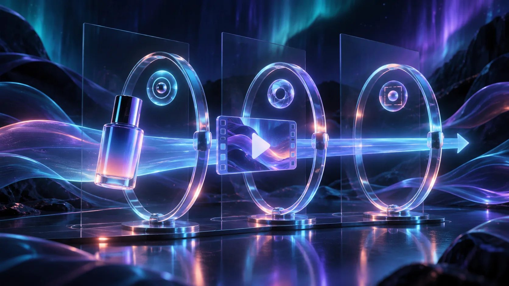
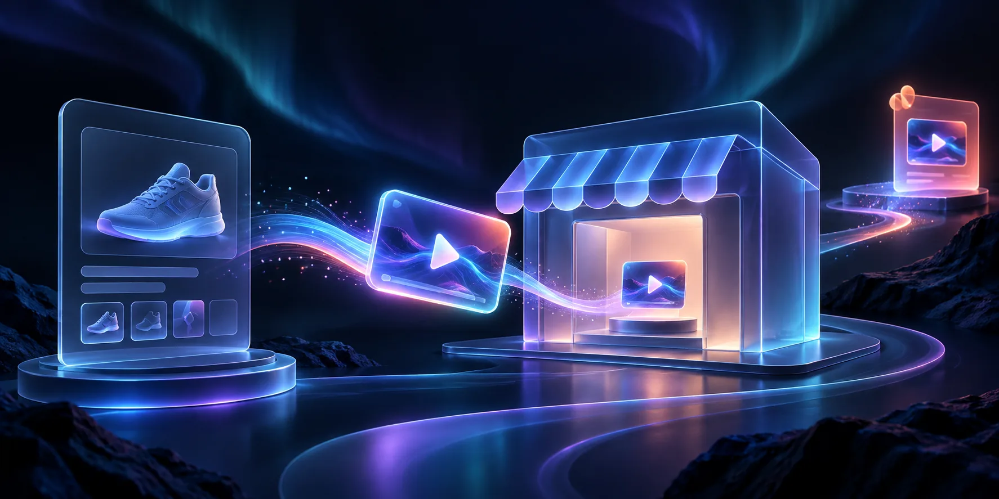

# How to Create a Shopify UGC Video That Answers One Buyer Question

A useful Shopify UGC-style video does not need to explain everything about a product. It should answer one buyer question—such as "Will this fit my small workspace?" or "What changes after I use it?"—with a short, reviewable sequence. Start with one approved product fact, turn it into a three-beat script, then add the finished video only where that question matters.

You need a Shopify product with accurate source material, one question your support or sales team sees repeatedly, and a clear reviewer. [Supra UGC Maker](https://apps.shopify.com/supra-ugc-maker) can build a scene with a model, environment, product, custom speech, and editable clips; it is a practical fit when you need variations without rebuilding every asset. It should not replace a real customer testimonial or a creator relationship when those are the evidence a shopper needs.

## 1. Choose one question with a factual answer

Do not begin with "make a great ad." Open a product page, support inbox, or sales notes and capture one question that can be answered without making a promise you cannot substantiate. Good candidates are:

- What is included in the box?
- How does this product fit into a morning routine?
- Which product detail makes this version different?
- What should a buyer check before choosing a size, finish, or configuration?

Write the question as the viewer would ask it, then attach the exact source for the answer: approved product copy, specifications, care instructions, or a confirmed demonstration. If the answer depends on the buyer or is a subjective outcome, state the condition rather than turning it into a guarantee.

**Expected result:** you have one question, one supported answer, and one product asset to show. That is much easier to review than a loose creative brief. If you need to go deeper on handling objections, use this earlier guide on [creating a Shopify UGC video for one customer objection](https://how-to.the-lean-ecommerce.com/2026/10/11/how-to-create-a-shopify-ugc-video-for-one-customer-objection/).

## 2. Convert the answer into a three-beat script

Keep the first version intentionally small. The objective is not a finished campaign; it is a clear demonstration of one decision. Use this reusable structure:

| Beat | Purpose | What to include |
| --- | --- | --- |
| Hook | Name the question | The product and the situation where the question appears |
| Proof | Give the supported answer | One visible product detail, use case, or step |
| Next action | Tell the buyer what to do | Check a specification, choose an option, or continue to the product page |

For example, for a compact desk lamp, the draft could be: "Need light for a small desk? This lamp has a low-profile base and an adjustable head, so you can aim light at the work surface. Check the dimensions on the product page before choosing your setup." Notice what is absent: invented performance claims, a fake review, and a discount that may expire.

Keep a record of the product claim and source next to the script. That same discipline is useful when creating a [reviewable AI video pipeline with VideoJSON](https://how-to.the-lean-ecommerce.com/2026/10/24/how-to-build-a-reviewable-ai-video-pipeline-with-videojson/): inputs should be specific enough that a reviewer can find what changed.

**Expected result:** the script can be read aloud in one short segment and every factual statement has an owner.

## 3. Build the scene around the evidence, not around novelty

In Supra UGC Maker, select an avatar or custom AI model, set an environment, add the relevant Shopify product, then enter the approved script and voice/tone. The app’s listing says you can preview scenes, reorder or trim clips, update speech, and create new variations from reusable projects. Use those controls to keep the visual setup consistent while changing only the decision you are testing.

Choose a setting that helps the viewer understand the product. A kitchen tool belongs near a believable work surface; a travel accessory needs a packing or transit context. If a scene hides the product, distorts a material, or implies a feature you cannot show, change the scene rather than trying to explain the discrepancy in the caption.

For a product-page video, verify that your Shopify theme supports video media before publishing. Shopify documents that videos and 3D models need compatible theme support, and you can add media from the product’s Media section in admin. See Shopify’s [product media guidance](https://help.shopify.com/en/manual/products/product-media/add-media) for the current workflow and limits.

**Expected result:** the product, setting, spoken answer, and intended placement agree with each other.

## 4. Review the video with a five-point gate

Watch the entire export before you place it in an ad or on a product page. Use this quick gate:

1. **Product accuracy:** Does the product shown match the selected variant, color, material, and included items?
2. **Script accuracy:** Does every spoken claim match the approved source?
3. **Audience clarity:** Can a first-time shopper repeat the answer after watching once?
4. **Context honesty:** Is it clear that this is an AI-generated UGC-style creative, not a real customer testimonial?
5. **Placement fit:** Does the CTA match the page or campaign where the video will appear?

If the answer is no, regenerate only the affected scene or speech segment. Avoid treating a visually polished video as approved when its claim or product details are wrong. The same review habit applies to broader launch assets; see [how to create a reviewable SaaS demo video from a website](https://how-to.the-lean-ecommerce.com/2026/10/15/how-to-create-a-reviewable-saas-demo-video-from-your-website/) for a complementary evidence-first workflow.

**Expected result:** you can show a reviewer the source, script, export, and intended placement in a single pass.

## 5. Put the video where the question occurs

Use the buyer question to choose the location. A question about dimensions, use, or product setup may belong on the product page. A question that introduces a new collection may belong in a paid-social variation or launch email. Do not upload the same asset everywhere by default: the next action should change with the context.

Shopify lets you add a video to product media and choose the featured media order. Keep the core product images visible, then place the video where it supports the buying decision rather than interrupting it. For a campaign-focused version, keep the project and scene reusable so the hook, voice, or CTA can change without rebuilding the product evidence.

## A small test plan before you scale

Create two versions only: one with the current buyer question and one with a different approved hook. Keep the product, destination, and CTA stable. Record which version was used, where it appeared, and what you will review—qualified clicks, product-page engagement, support questions, or another outcome that fits your store.

This is a better starting point than producing dozens of disconnected assets. When you later need an announcement-style variation, [turn release notes into a product trailer](https://how-to.the-lean-ecommerce.com/2026/10/13/how-to-turn-release-notes-into-a-product-trailer/) with the same source-first discipline.

## Create the first answer, then the next variation

A focused Shopify UGC video is a compact answer, not a substitute for product truth. Select one recurring buyer question, ground the script in approved product information, review the generated creative, and place it beside the decision it helps a shopper make.

Start with one product and one question in [Supra UGC Maker](https://apps.shopify.com/supra-ugc-maker). Its free plan is useful for a bounded first experiment; check the current plan limits before planning a larger production run.
