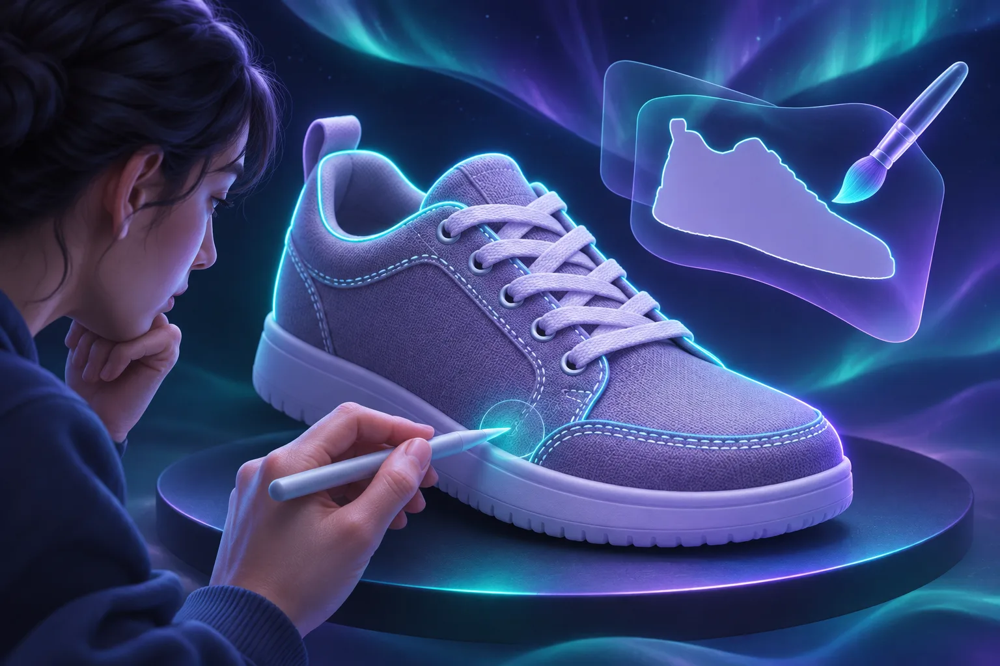
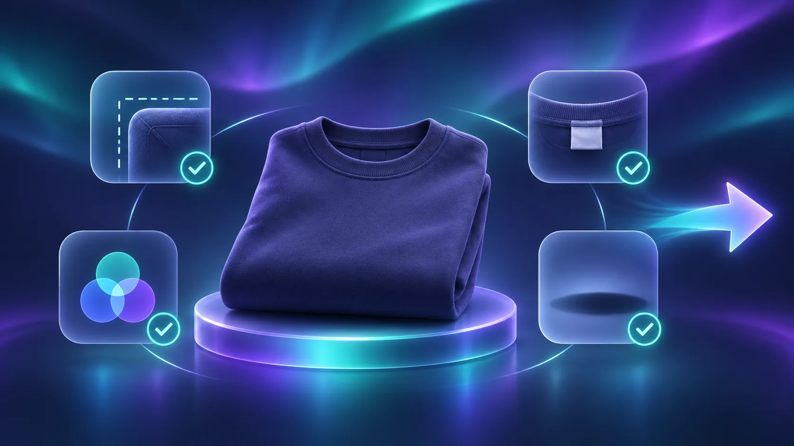

# How to Check Product Photo Fidelity After Background Removal

A clean background can make a product listing easier to scan, but it can also hide a bad edge, a missing detail, or a color shift. To keep the listing honest, remove the background with a mask, preserve the original pixels, then inspect the edge, label, color, and shadow before export. You can do this in a browser with [ImageFlow](https://imageflow.dev/), which provides layers, masks, adjustment layers, and on-device selection tools.

You need one original product image, a target background (or transparent export), and a few uninterrupted minutes to review at 100% zoom. This is a quality-control pass, not a reason to reshape the item, erase included parts, or change its colour.

## 1. Duplicate the source layer before selecting anything

Open the original image and duplicate its base layer. Lock or hide the untouched copy and do the edit on the duplicate. This gives you an immediate visual reference if an edge begins to look too clean, too sharp, or incomplete.

ImageFlow runs in the browser and supports layered, editable documents, including PSD and PSB import and export. If you are working from a layered source rather than a flat image, keep the received document intact and make a new version for the listing edit.

**Expected result:** one original layer remains available for comparison, and one working layer is ready for masking.

## 2. Make a first selection, then turn it into a mask

Use ImageFlow's object or subject selection to get a starting outline. For a simple hard-edged item, that may be close to sufficient. For hair-like fibres, clear plastic, metal reflections, fine straps, or perforations, treat the automatic result as a draft.

Convert the selection to a layer mask rather than deleting pixels. A mask makes it possible to paint an area back in when the selection removes a real part of the product. It is also the safer choice when you need the same item on more than one background.

Check these areas at 100% zoom:

- Outside contours: handles, straps, laces, corners, and loose fibres.
- Interior gaps: holes, translucent sections, open packaging, and negative space.
- Printed information: labels, marks, care symbols, and size details.
- Reflective edges: chrome, glass, gloss, and cast highlights.

**Expected result:** the subject is isolated, but every uncertain area is still editable through the mask.

## 3. Put the cutout on a temporary contrast background

Add a solid layer below the product and choose a colour that contrasts with the item. A dark temporary background often exposes pale halos; a light one can expose dark fringing. Toggle between two contrasting backgrounds before you decide the mask is finished.

This is a useful extension of the workflow in [how to refine product photo masks in your browser](https://how-to.the-lean-ecommerce.com/2026/10/23/how-to-refine-product-photo-masks-in-your-browser/): the goal is not a mathematically perfect contour, but an edge that accurately represents the physical product in the listing context.

Do not use cleanup to remove a feature a shopper would receive. If an object is genuinely distracting in the original scene, [remove it carefully with a review step](https://how-to.the-lean-ecommerce.com/2026/10/30/how-to-remove-a-distracting-object-from-a-product-photo-in-your-browse/) rather than treating content-aware fill as a substitute for product truth.

**Expected result:** halos, clipped material, and missed gaps are visible before the final background makes them harder to notice.

## 4. Correct light and colour with adjustment layers only

If the product needs a small exposure, contrast, or colour correction, add an adjustment layer above the working layer. Keep the original pixels below it. That lets you lower or remove the adjustment if the product starts to look unlike the item a customer will receive.

Use this decision rule:

| If the change fixes… | It is normally appropriate when… | Stop when… |
| --- | --- | --- |
| Overall exposure | The item is difficult to see but details stay unchanged | The correction alters material or colour |
| Background spill | A neutral edge is needed after masking | The edge looks cut out or loses texture |
| A cast shadow | It anchors the product without changing its shape | The shadow implies a different size or position |
| A label or logo | Never recolour, erase, or obscure a real identifier | The listing no longer shows the actual item |

For related guardrails, see [how to clean up a product photo in your browser without changing it](https://how-to.the-lean-ecommerce.com/2026/10/15/how-to-clean-up-a-product-photo-in-your-browser-without-changing-it/) and [how to relight a product photo without misrepresenting it](https://tools-and-how-tos.github.io/2026/11/06/how-to-relight-a-product-photo-without-misrepresenting-it/).

**Expected result:** edits improve legibility while the original product's dimensions, materials, details, and colour remain recognizable.

## 5. Run the four-point listing check before export

Before exporting, hide the temporary background and compare the working layer against the original. Then review this short checklist:

1. **Edge:** no clipped straps, fibres, corners, or transparent pieces.
2. **Colour:** the item has not drifted warmer, cooler, brighter, or more saturated than the source.
3. **Identifiers:** labels, logos, included accessories, and important construction details remain visible and truthful.
4. **Shadow:** any retained or added shadow supports the object without changing the perceived shape or scale.

Preview the image at its likely storefront size as well as at 100%. A tiny defect that appears only at full size may not matter on a collection card; a clipped handle that disappears at card size still matters. If you are exporting variants, use the same check for each one—[a clean master is the safest starting point for reusable variants](https://tools-and-how-tos.github.io/2026/11/02/how-to-make-shopify-product-image-variants-without-replacing-the-maste/).

## 6. Export a deliberate listing version

Save the layered working file first, then export the listing image. Name the export with the product identifier and intended use, such as `ceramic-mug-white-main.png`, rather than overwriting the source. Keep the final output alongside the editable version so a later request for a different crop or background begins from real source material.

If you need a compact handoff process, [this product-image metadata check](https://the-lean-ecommerce.github.io/2026/11/08/a-shopify-product-photo-metadata-check-before-you-share-a-sample/) is a useful companion to the visual review.

## A cleaner background is only successful when the product stays true

Background removal should make the product easier to evaluate, not different from what a shopper receives. Start with one real photo in [ImageFlow](https://imageflow.dev/), keep the edit masked and layered, and run the four-point check before you publish. The smallest useful correction is usually the one that protects both the image and the buyer's expectation.
