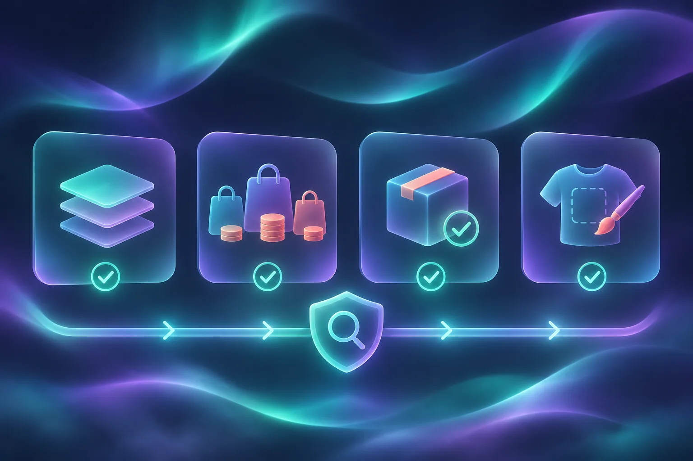

# How to Preflight an Etsy Meta Catalog Feed Before a Seasonal Promotion

A seasonal promotion is the wrong time to discover that a sale price, color variation, or made-to-order item arrived in your catalog differently than it appears on Etsy. Before you connect a feed to Meta Commerce Manager, run a small preflight: choose the listings you intend to promote, inspect how variants become rows, decide how to handle personalization, and test-import a short sample. **Catalog Generator for Etsy** can generate a live feed from your Etsy connection; its current documentation says that priced variations become individual catalog rows and that personalization handling can be configured in the feed URL.

You will need an Etsy shop, access to your Meta business/catalog tools, and a small group of representative listings. This is an import-quality check, not a promise of catalog, domain, or commerce-account approval.

## 1. Define the promotion slice before touching the feed

Write down the exact group you want shoppers to see: for example, 12 giftable listings, their available colors, and the date your promotion starts. Include one item that has variations, one that is low in stock, and one personalized listing if you sell them.

The expected result is a short sample that represents your risky cases—not a random selection of your easiest products. A feed may technically import while still being the wrong merchandising slice for a promotion.

Use this quick decision table while you choose the sample:

| Listing condition | Include in the sample? | What to inspect |
| --- | --- | --- |
| Several priced sizes or colors | Yes | Each purchasable option should have the price and availability you expect |
| Personalization field | Yes, if you sell it | The product is represented in the way you chose for your feed |
| Made-to-order or limited stock | Yes | Availability and shipping expectations remain accurate |
| Draft or inactive listing | Only intentionally | It does not appear by accident |

If your seasonal work also includes price changes, use the same discipline as this [Shopify bulk-edit pilot](https://tools-and-how-tos.github.io/2026/11/08/a-shopify-bulk-edit-pilot-for-catching-variant-scope-mistakes/): prove the scope with a small sample before scaling the operation.

## 2. Create or review the live feed settings

Open [Catalog Generator for Etsy](https://catalog-generator.webyze.com/) and connect the Etsy shop only after confirming you are in the right shop account. The product describes itself as a read-only connection that builds a live feed; it also documents settings for variation expansion, draft/inactive inclusion, and personalization handling.

Set those options intentionally. For a promotion, do not include drafts or inactive listings just because you want a bigger count. Likewise, do not assume a personalized product behaves like a ready-to-ship product; decide whether it belongs in this campaign and verify how the feed represents it.

Copy the resulting feed URL somewhere private. Treat it as a configuration artifact: if you later change variation or inclusion settings, you have changed the data source that Meta will read.

The expected result is one feed URL whose inclusion rules you can explain in a sentence.

## 3. Verify variation rows before you import

Catalog Generator’s current product page says each priced size, color, or option is emitted as its own row with the correct price and stock. Check that claim against your chosen Etsy listings instead of assuming every option has the same price.

For each sample listing, compare these four values between Etsy and the feed/catalog preview:

1. The visible option name, such as color or size.
2. The price for that specific purchasable option.
3. Its availability or stock state.
4. The destination URL and image that identify the intended listing.

This is the useful distinction: a *listing* can be a product concept, while a *catalog row* needs to represent a shopper-selectable offer. If a red large item is priced differently from a blue small item, the row-level values matter more than the parent listing’s headline price.

## 4. Test-import the feed into the catalog before scheduling the campaign

In Meta Commerce Manager, add the feed as a data source using its URL rather than uploading a static file. The Catalog Generator walkthrough shows this URL-based workflow, and the product’s current site positions the result as a feed for Meta Commerce Manager.

Start with the sample you defined in step 1. Once processing finishes, inspect item count and the representative rows. Do not launch a promotion while the import is still processing or while errors are unresolved.

Expected result: your sample products appear with the intended titles, images, prices, and availability. If you see a mismatch, pause here. Fix the Etsy listing or feed configuration, then re-run the sample import. A clean retry is cheaper than correcting a live catalog mid-promotion.

This same “small evidence pack first” approach is useful beyond catalogs. For example, [building a website evidence pack before generating a startup video](https://tools-and-how-tos.github.io/2026/11/05/build-a-website-evidence-pack-before-generating-a-startup-video/) uses a bounded source set to make the next system reliable.

## 5. Run the four-point preflight on the promotion date

Run this checklist once more after final Etsy edits and before you turn on ads or product tags:

- **Scope:** Only the listings you meant to promote are included.
- **Variants:** A few high-risk variants still show the correct price and availability.
- **Personalization:** Personalized items match the handling rule you selected.
- **Destination:** A click from a representative catalog item reaches the correct Etsy listing.

If something changed after your first import, do not rely on memory. Record what changed, wait for the next configured fetch or refresh the data source according to the options available in your catalog tools, and recheck the affected rows. This is the catalog equivalent of a [five-record receipt for a Shopify bulk edit](https://the-lean-ecommerce.github.io/2026/11/05/i-reconcile-shopify-bulk-edits-with-a-five-record-receipt/).

## Common preflight failures

**The item count looks right, but the promotion is still wrong.** Counts cannot prove that prices or options are correct. Inspect representative variation rows.

**A personalized listing appears unexpectedly.** Review the feed setting that controls personalization before removing products manually in another system; otherwise the next refresh may reintroduce the mismatch.

**A product is missing.** First verify whether it is active in Etsy and whether the feed’s inclusion rules exclude it. Then check the catalog’s diagnostics before changing several settings at once.

**You are tempted to repair everything in Commerce Manager.** Correct the source or feed configuration where possible. Manual downstream edits make the next sync harder to reason about. The same principle helps when you [test a Notion-to-Webflow schema change before auto-sync](https://productivity-tech-business.sktch.io/home/how-i-test-a-notion-to-webflow-schema-change-before-auto-sync-QRm7+daKgRiGbP3safopYA): keep the source of truth clear.

## Next action

A reliable seasonal catalog promotion begins with a small, representative import—not a full-catalog leap of faith. Choose your sample, set the feed inclusion rules, validate variation rows, and only then scale to the full promotion.

If you need a live Etsy feed for Meta or Google Shopping, [start the Catalog Generator for Etsy free trial](https://catalog-generator.webyze.com/), configure one deliberate feed, and run the four-point preflight before the campaign date.
