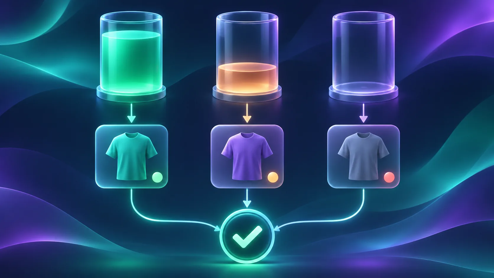

# How to Check Etsy Feed Variant Availability After a Sell-Out

When an Etsy variation sells out, do not assume your Meta catalog has caught up. Check one deliberately chosen listing after the next scheduled feed pull: its Etsy availability, the feed row, and the catalog item should tell the same story. This small control test catches a stale buyable option before it becomes a customer-facing problem.

You need an Etsy shop connected to [Catalog Generator for Etsy](https://catalog-generator.webyze.com/) and an existing catalog data source in Meta Commerce Manager. Catalog Generator reads Etsy listings and creates a feed URL; Meta's scheduled-feed configuration retrieves inventory from a public URL on a recurring basis. That means a change on Etsy and a visible catalog change are related, but not instantaneous.


## 1. Pick a control listing with a meaningful variant change

Choose one active listing with two or more purchasable variations. A size or color with separate quantity is ideal. Etsy supports variations that affect price, quantity, processing profile, or SKU; use a variation whose quantity you can identify unambiguously in [Etsy's variation settings](https://help.etsy.com/hc/en-us/articles/115015664047-How-to-Add-Variations-to-Your-Listings).

Record four values before you change anything:

1. Etsy listing URL and listing title.
2. The exact variation label, such as `Blue / Large`.
3. Its current quantity or its current sold-out state.
4. The current catalog item and variant status in Commerce Manager.

The expected result is a compact before-state you can compare later. Do not use a vague note such as “the mug listing looked fine”; the variation is the unit you are checking.

## 2. Make one reversible Etsy inventory change

Set the selected variation to quantity zero, or use a listing that has just genuinely sold out. Do not change title, price, photos, and inventory together. A single-variable test makes a mismatch diagnosable. Etsy notes that an option whose quantity is zero appears as sold out, and a fully sold-out listing is removed from the shop.

If you are testing a live item, use a small quantity and restore it after the check. Do not deactivate a listing merely to simulate a stock event unless hiding it is your actual operating decision: Etsy treats deactivation as a different listing state.

| Checkpoint | What should change | What must stay stable |
| --- | --- | --- |
| Etsy variation | Quantity/availability for the chosen option | Listing URL, product identity, other options |
| Feed refresh | The next pull should read the new source state | The feed URL and source connection |
| Catalog item | That option should no longer be presented as purchasable | The parent item and unaffected variants |

## 3. Confirm the feed source is still the intended Catalog Generator URL

Open the data source in Commerce Manager and confirm it is the URL supplied by Catalog Generator, not an old downloaded file or a second test feed. Catalog Generator provides a feed for Meta and can include Etsy variations as distinct catalog rows; Meta's feed onboarding documentation describes a feed URL as the source for catalog inventory.

Also check the refresh schedule and the most recent retrieval status. Write down the time of the Etsy change and the planned or completed pull time. This is not busywork: it separates “not refreshed yet” from “refreshed, but wrong.”

For a broader source-and-destination agreement, see our [Etsy catalog feed contract](https://the-lean-ecommerce.github.io/2026/11/13/build-an-etsy-catalog-feed-contract-before-you-import-to-meta/).



## 4. Wait for the scheduled pull, then inspect the exact variant

After the recorded refresh runs successfully, locate the chosen item in Commerce Manager. Inspect the variation that changed—not just the parent product card. Match its option label, availability, and any price you did not intend to change.

Use this decision rule:

- **Etsy and catalog both show unavailable:** the control check passes. Restore the test quantity only if this was a deliberate simulation.
- **Etsy shows unavailable but the catalog is still purchasable:** first confirm the last retrieval occurred after your Etsy edit. If it did, treat it as a feed or mapping problem, not a waiting problem.
- **The parent listing is missing:** check whether the listing was deactivated, expired, or sold out entirely before changing feed settings.
- **A different variation changed:** compare option labels and SKU/price mapping; the test may be pointing at the wrong row.

This is the useful distinction behind a [catalog reconciliation after a listing change](https://tools-and-how-tos.github.io/2026/11/18/how-to-reconcile-an-etsy-catalog-feed-after-a-listing-change/): a successful retrieval alone does not prove the shopper-facing variant is right.

## 5. Run a short recovery path for a mismatch

If the retrieval timestamp is older than the Etsy edit, wait for or initiate the next permitted refresh and repeat the exact-variant check. If the timestamp is newer, verify the feed URL and the listing's current Etsy state before editing the catalog manually. Manual catalog edits can mask the source problem and will be overwritten by a later feed pull.

For a variant-specific troubleshooting sequence, use [How to Fix Missing Etsy Variations in a Meta Catalog Feed](https://how-to-blog.gitlab.io/2026/11/17/how-to-fix-missing-etsy-variations-in-a-meta-catalog-feed/). If you are preparing a larger promotion, add this control check to the [seasonal feed preflight](https://how-to.the-lean-ecommerce.com/2026/11/10/how-to-preflight-an-etsy-meta-catalog-feed-before-a-seasonal-promotion/).

## 6. Keep a one-line release receipt

Save a short record where your team can find it:

```text
2026-11-19 — Etsy: Blue / Large set to sold out — feed pull: 14:00 UTC — Meta: unavailable — checked by: name
```

The point is not to create paperwork for every sale. It is to prove the connection behaves as expected after a meaningful inventory event, so the next discrepancy has a known-good baseline.


## Keep the catalog honest between refreshes

A scheduled feed is a practical automation, not a promise of immediate inventory propagation. Use Catalog Generator's feed URL as the single source path, test one exact variation after an important sell-out or stock change, and keep the result with the refresh time. Your next action is simple: choose one multi-variation Etsy listing and run this control check after its next scheduled pull.
